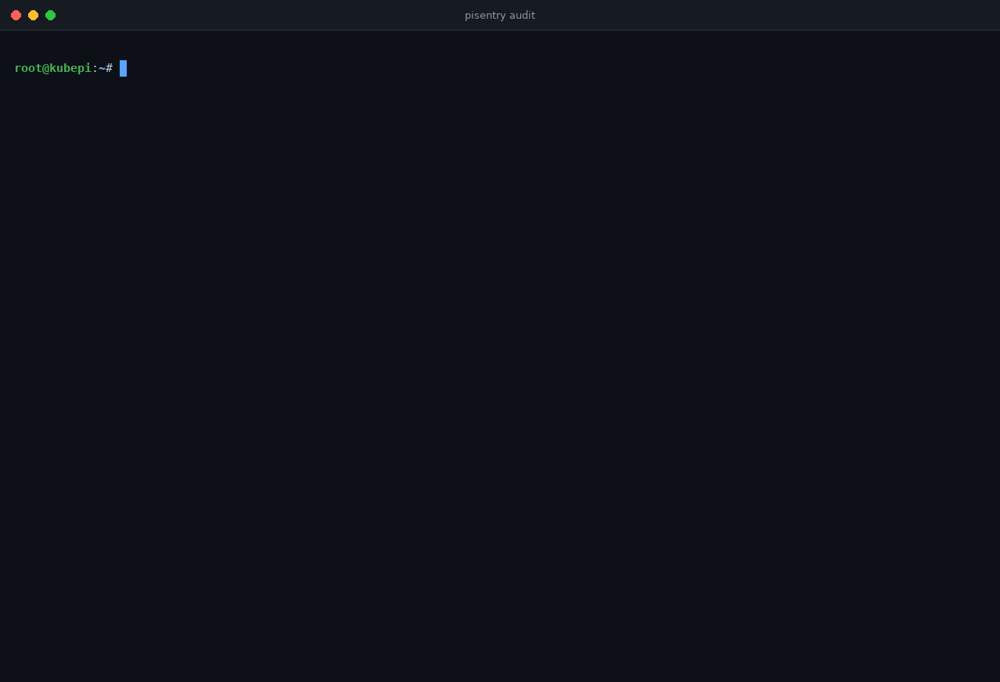
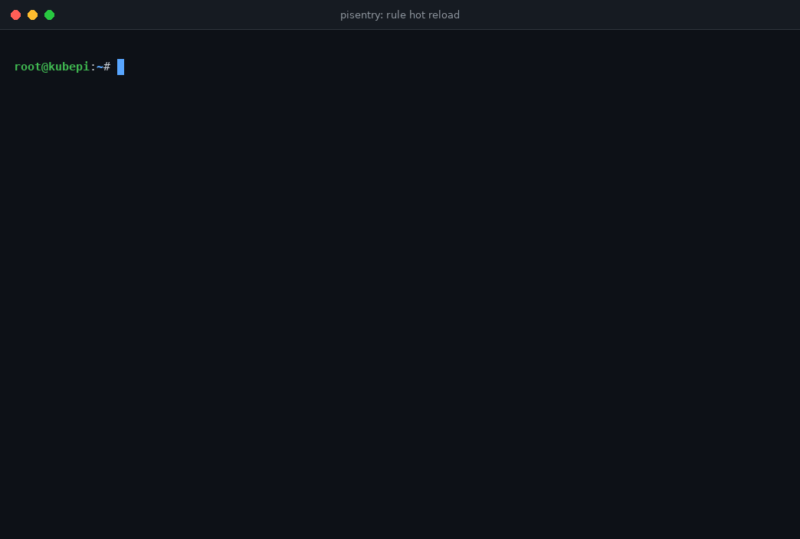

<p align="center">
  <picture>
    <source media="(prefers-color-scheme: dark)" srcset="docs/assets/readme-banner-dark.svg">
    <source media="(prefers-color-scheme: light)" srcset="docs/assets/readme-banner-light.svg">
    
  </picture>
</p>

[](https://github.com/MrGuato)
[](https://mrguato.github.io/pisentry/)
[](https://github.com/MrGuato/pisentry/actions/workflows/ci.yml)
[](https://github.com/MrGuato/pisentry/actions/workflows/codeql.yml)
[](https://github.com/MrGuato/pisentry/actions/workflows/release.yml)


[](https://github.com/MrGuato/pisentry/pkgs/container/pisentry)

[](https://scorecard.dev/viewer/?uri=github.com/MrGuato/pisentry)


**A single static binary that watches a small Linux host for the ten attacks that hit it most, ranks them, and tells you where to look first.**

> _Ten categories. One binary. Zero dependencies._

<p align="center">
  
</p>

<p align="center"><sub>A real recording, not a mock-up: the top pane fires harmless stand-ins for eight attacks, the bottom pane is <code>pisentry run</code> piped through <a href="scripts/demo/stream.jq">jq</a>, and the last frame is <code>pisentry report</code>. Rebuild it with <code>make demo</code> (<a href="scripts/demo/">how</a>).</sub></p>

- Standard library only. No third-party Go modules, nothing to audit but this repo and the Go toolchain
- About 7 MB on disk, about 12 MB resident. Under 1% CPU on a 2 GB Pi
- arm64 (Pi 4 and 5), armv7 (32-bit Pi OS), amd64
- Runs as a hardened systemd service or as a Kubernetes DaemonSet managed by Flux
- Raspberry Pi OS, Ubuntu, Debian and RHEL-family hosts, with journald or classic syslog files
- Prometheus metrics, JSON events, a terminal Top 10 report, and push alerts to ntfy, Discord, Slack or any webhook

<details>
<summary>The same report as text</summary>

```
$ sudo pisentry report
pisentry Top 10  |  host kubepi  |  last 24h  |  2026-10-15 14:02 EDT

#   ID    CATEGORY                 EVENTS  WORST     LAST SEEN  ALL TIME  MITRE
1   PS06  Cryptominer              2       critical  35s ago    2         T1496
2   PS07  Unexpected listener      2       critical  38s ago    2         T1571
3   PS02  Suspicious login         1       critical  40s ago    1         T1078
4   PS08  Reverse shell            1       critical  39s ago    1         T1059.004
5   PS01  SSH brute force          1       high      40s ago    1         T1110
6   PS04  Privilege escalation     1       high      40s ago    1         T1548.001,T1548.003
7   PS09  Port scan                1       high      40s ago    1         T1046
8   PS03  Insecure posture         1       medium    1m ago     1         T1078.001,T1021.004
9   PS05  Persistence              0       clean     -          0         T1053.003,T1543.002,...
10  PS10  Critical file tampering  0       clean     -          0         T1574.006,T1556.003,...
```

That output is from a real run against the bundled attack simulation.

</details>

---

## Why this exists

I run a k3s cluster on Raspberry Pis and one x86 box, all declared in Git. Falco watches the container runtime there, and it is good at that. Nothing small watched the hosts underneath: the auth log filling up with failed root logins, a sudoers drop-in appearing, a new line in `authorized_keys`, password auth still on, the `pi` user still having a password. The tools that do cover that side are built for fleets of servers and want a manager, a database, or 500 MB of RAM.

pisentry is the host-side agent I wanted: one binary, one JSON config, a Top 10 that tells you what matters this week, and output you can graph and alert on. It runs next to Falco, not instead of it.

Falco sees a syscall the moment it happens; pisentry covers the host underneath it. The [comparison](https://mrguato.github.io/pisentry/#compare) has the details.

---

## Quick start

Audit a Pi in four commands. No install, no daemon, exit code 2 if anything is High or Critical.

```bash
curl -fsSLO https://github.com/MrGuato/pisentry/releases/latest/download/pisentry-linux-arm64
curl -fsSLO https://github.com/MrGuato/pisentry/releases/latest/download/SHA256SUMS
sha256sum --check --ignore-missing SHA256SUMS
chmod +x pisentry-linux-arm64 && sudo ./pisentry-linux-arm64 audit
```



Use `pisentry-linux-armv7` on 32-bit Pi OS and `pisentry-linux-amd64` on x86. To keep it running, [install it](#install) as a service or a DaemonSet.

---

## The Top 10

| ID | Category | What triggers it | Source |
|---|---|---|---|
| PS01 | SSH brute force | 5 or more failed auths from one IP in 5 min (High). 20 or more is Critical | auth log |
| PS02 | Suspicious login | Success after 3 or more failures (Critical), direct root login (High), first login from a new source (Medium) | auth log |
| PS03 | Insecure posture | SSH password auth, root login, empty passwords, `pi` with a password, telnet/ftp, no auto-updates, weak sysctls | audit |
| PS04 | Privilege escalation | New SUID/SGID binary, sudoers change, user added to sudo/wheel/docker, `NOT in sudoers`, risky sudo commands | FIM, SUID walk, auth log |
| PS05 | Persistence | cron, systemd units (system and user), `authorized_keys`, rc.local, shell profiles, udev, motd, service account given a shell | FIM |
| PS06 | Cryptominer | Known miner names, stratum pool arguments, hot process running from /tmp, /dev/shm or a deleted binary, hot process connected to a pool port | /proc |
| PS07 | Unexpected listener | A socket listening that was not there during the learning period. Known backdoor ports are Critical | /proc/1/net |
| PS08 | Reverse shell | A shell or interpreter whose stdin, stdout or stderr is a TCP connection | /proc fd + net |
| PS09 | Port scan | One source hitting 12 or more distinct ports in 60s in firewall drop logs | kernel log |
| PS10 | Critical file tampering | passwd/shadow/group, PAM, sshd_config, `ld.so.preload`, new UID 0 account, new login account | FIM, audit |

Ranking is by severity-weighted score inside the window (critical 10, high 5, medium 2, low 1), then by count. Every category always shows, so the report reads as a status board even on a quiet day. Every event carries its MITRE ATT&CK technique IDs.

How the detectors feed the engine, and the learning period, cooldown and sanitizer behind them, are in [docs/reference.md](docs/reference.md#how-it-works).

---

## Install

**Bare metal (systemd):**

```bash
git clone https://github.com/MrGuato/pisentry && cd pisentry
sudo ./deploy/install.sh
```

The unit runs as root to read `/etc/shadow`, other users' `/proc` and the journal, and gives up everything else: two capabilities, a syscall filter, a read-only system and a 256 MB memory cap.

**Kubernetes with Flux:** copy `deploy/kubernetes/` into your cluster repo. You get a DaemonSet pinned by digest, a NetworkPolicy, a PodMonitor, the alert rules and the Grafana dashboard.

```bash
kubectl -n pisentry exec ds/pisentry -- pisentry report
```

Installer options, push alerts, the Flux layout and every pod grant with its reason are in [docs/install.md](docs/install.md).

---

## Commands

```
pisentry run        [-config FILE]                  run the agent
pisentry report     [-since 24h] [-json]            ranked Top 10 from saved state
pisentry audit      [-json]                         one-shot posture audit, exit 2 on high/critical
pisentry baseline   reset                           re-learn baselines (the running agent picks it up)
pisentry check      [-rules PATH]                   validate rule bundles, exit 1 naming the file, rule and field
pisentry test-alert                                 send a test webhook
pisentry categories                                 print the Top 10 catalog
```

`pisentry audit` works without the agent running, which makes it handy for hardening a fresh Pi. `pisentry report -json` and `pisentry audit -json` are stable machine-readable output for evidence collection.

---

## Custom rules, reloaded live

_On `main`, in the next release._

Drop a JSON bundle in `/etc/pisentry/rules.d/` ([Rule Schema v1](docs/rule-schema.md)) and the running agent picks it up within `rules.reload_interval` (10s), or right away on `sudo systemctl reload pisentry` (SIGHUP). No restart, no lost state.

The new rule set is compiled in the background and swapped in atomically, so detectors never see a half-loaded set. A broken file is rejected: the previous rules stay active, `pisentry_rules_reload_failures_total` goes up, and a PS00 event says which file and field. The agent never runs with zero rules. In Kubernetes the directory is watched, not the files, so a ConfigMap update (which swaps a `..data` symlink) is seen too.



---

## Outputs

One JSON event per line ([Event Schema v1](docs/event-schema.md), with OCSF and ECS mappings), Prometheus metrics on `:9817/metrics`, a small HTTP API, and webhooks for ntfy, Discord, Slack or any URL. High and Critical alerts are rate limited to 30 an hour, and Critical gets its own budget so a flood of High events cannot hide a reverse shell.

The bundled Grafana dashboard, here fed by the attack simulation and a real Prometheus running the shipped alert rules:


**Alerts** (on `main`, in the next release): ten Prometheus rules ship as a plain rules file and as a `PrometheusRule`, each with a one-line runbook. The most important one is the page the agent cannot send itself, `PisentryAgentAbsent`, because an attacker with root stops the agent first.

The full metric list, the alert table, the API and the configuration keys are in [docs/reference.md](docs/reference.md).

---

## Prove it works

After the learning period:

```bash
sudo ./scripts/simulate-attacks.sh
sudo pisentry report -since 10m
```

This fires PS01, 02, 04, 05, 06, 07, 08 and 09 with harmless stand-ins: fake log lines from documentation IP ranges, a copy of `sleep` named xmrig, a reverse shell to the host's own IP, and a comment-only cron file. Nothing leaves the machine, and everything is cleaned up when the script exits.

No root, and nothing touched on your own host? The same eight categories run inside a container:

```bash
make sim
```

It exits non-zero unless all eight categories fired. See [scripts/sim-container/](scripts/sim-container/).

---

## Limitations

Read this section before the feature list. It is the part that tells you whether pisentry fits.

- **Polling, not syscalls.** A process that lives less than one poll interval (15s) can be missed. Falco covers that gap.
- **Port scans need firewall logging.** pisentry reads kernel drop logs. It does not capture packets. Turn on `ufw logging on`, or `firewall-cmd --set-log-denied=all` on RHEL, or add an nftables `log` rule. Otherwise PS09 is blind.
- **Root wins.** An attacker who gets root can stop the agent or edit its state. Ship events off the box and alert when the agent goes quiet; the shipped alert rules do exactly that. That is the real defense.
- **A host that is already compromised learns a bad baseline.** Install on a clean host, or review the first FIM and listener baselines by hand.
- **Log forgery in file mode.** Any local user can write `sshd`-tagged lines with `logger`. With journald, `ssh_require_root` filters those out. Classic syslog files have no sender identity.
- **High UDP ports.** Unconnected UDP sockets on ports 32768 and up are skipped to avoid DNS-client noise, so a UDP backdoor on a high port will not show as a new listener.
- **FIM is hash-on-interval, not inotify.** A file changed and restored inside one interval (60s) is not seen.
- **FIM noise during upgrades.** Package installs touch watched paths. Severity drops one level while a package manager is running, but expect a few Low/Medium events after `apt upgrade`.
- **systemd hardening is strict.** If you point `output.json_file` outside `/var/log/pisentry`, add a `ReadWritePaths=` drop-in.
- **v0.1.** Tested with unit tests and live simulation in Linux containers and on a four-node k3s cluster, not across a fleet. Check `pisentry_detector_errors_total` after deploying.

---

## Security

pisentry is root-equivalent on the host it protects. The threat model, the supply-chain controls on releases, and how to report a vulnerability privately are in [SECURITY.md](SECURITY.md). Please do not open public issues for suspected vulnerabilities.

The detection logic is public on purpose. Thresholds are per-deployment configuration, and a detection that only works while its rules are secret is not a detection worth shipping.

---

## Roadmap

Real-time process events and fileless detection, persistent windows and attack-chain correlation, k3s checks, and opt-in active response. The live roadmap, built from the GitHub milestones, is at [mrguato.github.io/pisentry/roadmap.html](https://mrguato.github.io/pisentry/roadmap.html).

---

## Contributing

Bug reports, false positives and detection gaps are the most useful issues. See [CONTRIBUTING.md](CONTRIBUTING.md). The one hard rule: no third-party Go modules.

Every parser that reads attacker input (syslog lines, journal JSON, `/proc` stat and net tables, the auth and port-scan matchers, the sanitizer, the rule loader) has a native Go fuzz target. `make fuzz` runs each for 30 seconds; CI does the same on every pull request and runs 10 minutes per target weekly.

## License

[MIT](LICENSE)
