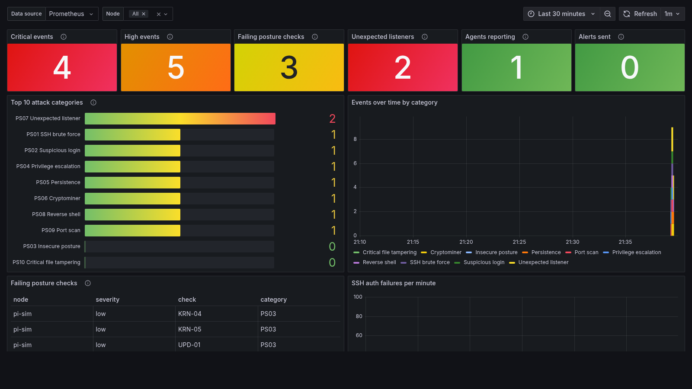

<p align="center">
  <picture>
    <source media="(prefers-color-scheme: dark)" srcset="docs/assets/readme-banner-dark.svg">
    <source media="(prefers-color-scheme: light)" srcset="docs/assets/readme-banner-light.svg">
    
  </picture>
</p>

[](https://github.com/MrGuato)
[](https://mrguato.github.io/pisentry/)
[](https://github.com/MrGuato/pisentry/actions/workflows/ci.yml)
[](https://github.com/MrGuato/pisentry/actions/workflows/codeql.yml)
[](https://github.com/MrGuato/pisentry/actions/workflows/release.yml)


[](https://github.com/MrGuato/pisentry/pkgs/container/pisentry)

[](https://scorecard.dev/viewer/?uri=github.com/MrGuato/pisentry)


**A single static binary that watches a small Linux host for the ten attacks that hit it most, ranks them, and tells you where to look first.**

> _Ten categories. One binary. Zero dependencies._

- Standard library only. No third-party Go modules, nothing to audit but this repo and the Go toolchain
- About 7 MB on disk, about 12 MB resident. Under 1% CPU on a 2 GB Pi
- arm64 (Pi 4 and 5), armv7 (32-bit Pi OS), amd64
- Runs as a hardened systemd service or as a Kubernetes DaemonSet managed by Flux
- Raspberry Pi OS, Ubuntu, Debian and RHEL-family hosts, with journald or classic syslog files
- Prometheus metrics, JSON events, a terminal Top 10 report, and push alerts to ntfy, Discord, Slack or any webhook

```
$ sudo pisentry report
pisentry Top 10  |  host kubepi  |  last 24h  |  2026-10-15 14:02 EDT

#   ID    CATEGORY                 EVENTS  WORST     LAST SEEN  ALL TIME  MITRE
1   PS06  Cryptominer              2       critical  35s ago    2         T1496
2   PS07  Unexpected listener      2       critical  38s ago    2         T1571
3   PS02  Suspicious login         1       critical  40s ago    1         T1078
4   PS08  Reverse shell            1       critical  39s ago    1         T1059.004
5   PS01  SSH brute force          1       high      40s ago    1         T1110
6   PS04  Privilege escalation     1       high      40s ago    1         T1548.001,T1548.003
7   PS09  Port scan                1       high      40s ago    1         T1046
8   PS03  Insecure posture         1       medium    1m ago     1         T1078.001,T1021.004
9   PS05  Persistence              0       clean     -          0         T1053.003,T1543.002,...
10  PS10  Critical file tampering  0       clean     -          0         T1574.006,T1556.003,...
```

That output is from a real run against the bundled attack simulation.

---

## Why this exists

I run a k3s cluster on Raspberry Pis and one x86 box, all declared in Git. Falco watches the container runtime there, and it is good at that. Nothing small watched the hosts underneath: the auth log filling up with failed root logins, a sudoers drop-in appearing, a new line in `authorized_keys`, password auth still on, the `pi` user still having a password. The tools that do cover that side are built for fleets of servers and want a manager, a database, or 500 MB of RAM.

pisentry is the host-side agent I wanted: one binary, one JSON config, a Top 10 that tells you what matters this week, and output you can graph and alert on. It runs next to Falco, not instead of it.

| | Falco | pisentry |
|---|---|---|
| Signal | Syscalls via eBPF | Logs, /proc, file hashes |
| Strength | Container runtime behavior | SSH and auth abuse, posture, FIM, host persistence |
| Needs | Privileged pod, kernel eBPF support | Three capabilities, no kernel features |
| Footprint | 128Mi request | 24Mi request |

Falco sees a syscall the moment it happens. pisentry sees the things Falco does not try to cover.

---

## Quick start

Audit a Pi in four commands. No install, no daemon, exit code 2 if anything is High or Critical.

```bash
curl -fsSLO https://github.com/MrGuato/pisentry/releases/latest/download/pisentry-linux-arm64
curl -fsSLO https://github.com/MrGuato/pisentry/releases/latest/download/SHA256SUMS
sha256sum --check --ignore-missing SHA256SUMS
chmod +x pisentry-linux-arm64 && sudo ./pisentry-linux-arm64 audit
```

```
FAIL    high      SSH-02  SSH root login permitted       PermitRootLogin yes
FAIL    medium    SSH-01  SSH password authentication enabled
...
How to fix:
  SSH-02: Set 'PermitRootLogin no' (or prohibit-password if you need key-based root).
```

Use `pisentry-linux-armv7` on 32-bit Pi OS and `pisentry-linux-amd64` on x86. To keep it running, install it as a service (next section) or deploy the DaemonSet.

---

## The Top 10

| ID | Category | What triggers it | Source |
|---|---|---|---|
| PS01 | SSH brute force | 5 or more failed auths from one IP in 5 min (High). 20 or more is Critical | auth log |
| PS02 | Suspicious login | Success after 3 or more failures (Critical), direct root login (High), first login from a new source (Medium) | auth log |
| PS03 | Insecure posture | SSH password auth, root login, empty passwords, `pi` with a password, telnet/ftp, no auto-updates, weak sysctls | audit |
| PS04 | Privilege escalation | New SUID/SGID binary, sudoers change, user added to sudo/wheel/docker, `NOT in sudoers`, risky sudo commands | FIM, SUID walk, auth log |
| PS05 | Persistence | cron, systemd units (system and user), `authorized_keys`, rc.local, shell profiles, udev, motd, service account given a shell | FIM |
| PS06 | Cryptominer | Known miner names, stratum pool arguments, hot process running from /tmp, /dev/shm or a deleted binary, hot process connected to a pool port | /proc |
| PS07 | Unexpected listener | A socket listening that was not there during the learning period. Known backdoor ports are Critical | /proc/1/net |
| PS08 | Reverse shell | A shell or interpreter whose stdin, stdout or stderr is a TCP connection | /proc fd + net |
| PS09 | Port scan | One source hitting 12 or more distinct ports in 60s in firewall drop logs | kernel log |
| PS10 | Critical file tampering | passwd/shadow/group, PAM, sshd_config, `ld.so.preload`, new UID 0 account, new login account | FIM, audit |

Ranking is by severity-weighted score inside the window (critical 10, high 5, medium 2, low 1), then by count. Every category always shows, so the report reads as a status board even on a quiet day. Every event carries its MITRE ATT&CK technique IDs.

---

## How it works

```
 journald / auth.log / kern.log ─┐
                                 ├─> auth detector ─────┐
                                 └─> port-scan detector ┤
 /proc (every 15s) ──> miner + reverse-shell detector ──┤
 /proc/1/net (30s) ──> listener detector ───────────────┤
 /etc, /home, cron, systemd (60s) ──> FIM ──────────────┼─> engine ─┬─> state.json (baselines, Top 10 history)
 /usr, /tmp, /home (6h) ──> SUID walk ──────────────────┤  dedupe   ├─> /metrics  (Prometheus)
 sshd_config, shadow, sysctl (6h) ──> posture audit ────┘  sanitize ├─> stdout JSON (journald / kubectl logs)
                                                                    └─> webhook (ntfy, Discord, Slack, generic)
```

- **Learning period.** For the first 10 minutes (15 in Kubernetes) pisentry records listeners and login sources without alerting. FIM and SUID baselines are taken on the first scan. Baselines persist in `/var/lib/pisentry/state.json`.
- **Alert once, then adopt.** A changed file alerts once and the new hash becomes the baseline. A new listener alerts once and stays counted in `pisentry_unexpected_listeners` until it goes away or you re-baseline.
- **Cooldown.** The same category and key will not re-fire for 15 minutes, so one brute-force campaign is one alert.
- **Package manager awareness.** If apt/dpkg/dnf is running when a watched file changes, severity drops one level and the event says so.
- **One choke point for untrusted strings.** Usernames, process names, paths and command lines come from the attacker. They pass through one sanitizer (control characters, terminal escapes, bidi overrides, invalid UTF-8, length) before they reach JSON, a webhook or your terminal.

---

## Install: bare metal (systemd)

```bash
git clone https://github.com/MrGuato/pisentry && cd pisentry
sudo ./deploy/install.sh                      # downloads the latest release for this CPU
sudo ./deploy/install.sh --version v0.1.0     # or a specific release
sudo ./deploy/install.sh --binary ./pisentry  # or a binary you built with make build
```

The installer puts the binary in `/usr/local/bin`, config in `/etc/pisentry/config.json`, secrets in `/etc/pisentry/pisentry.env` (mode 0600), and enables `pisentry.service`.

The unit runs as root because it has to read `/etc/shadow`, other users' `/proc/<pid>/fd` and the journal. Everything else is taken away: a two-capability bounding set, `ProtectSystem=strict`, `NoNewPrivileges`, a `@system-service` syscall filter, `MemoryDenyWriteExecute`, and a 256 MB memory cap (the process uses about 12 MB; the rest is room for kernel file cache that is charged to the unit). Read [deploy/systemd/pisentry.service](deploy/systemd/pisentry.service) before you trust it.

To enable push alerts with ntfy, set `"type": "ntfy"` under `alerts` in config.json and put this in pisentry.env:

```
PISENTRY_WEBHOOK_URL=https://ntfy.sh/a-long-random-topic-name
```

Then run `sudo systemctl restart pisentry && sudo pisentry test-alert`.

---

## Install: Kubernetes with Flux

`deploy/kubernetes/` mirrors the [pi-cluster](https://github.com/MrGuato/pi-cluster) layout:

```
deploy/kubernetes/
├── apps/base/pisentry/      namespace, configmap, daemonset, networkpolicy, podmonitor, grafana dashboard
└── apps/staging/pisentry/   overlay + secret.yaml.example (SOPS-encrypt before committing)
```

There is no separate Flux Kustomization. pi-cluster's `apps` Kustomization points at `./apps/staging` with no root `kustomization.yaml`, so Flux already picks up every subdirectory. A second Kustomization for the same path would give the objects two owners.

1. Tag a release (`git tag -s v0.1.0 && git push origin v0.1.0`). The release workflow pushes `ghcr.io/mrguato/pisentry:v0.1.0` for arm64, arm/v7 and amd64 with provenance and an SBOM. New ghcr packages start private, so set it to public once, or add an imagePullSecret.
2. Pin the image by digest in the DaemonSet (`image: ghcr.io/mrguato/pisentry:v0.1.0@sha256:...`). This agent is root-equivalent on every node. A tag can move, a digest cannot.
3. Copy both paths into your cluster repo and merge to `main`. The `apps` Kustomization reconciles it. Kustomize applies atomically, so check `kubectl version` first: the DaemonSet uses `appArmorProfile` (1.30+). On an older API server that field fails the whole `apps` apply.
4. Optional alerts: copy `secret.yaml.example` to `secret.yaml`, fill it in, encrypt it with `sops --config clusters/staging/.sops.yaml --encrypt --in-place`, then uncomment it in the overlay.

```bash
kubectl -n pisentry get ds pisentry
kubectl -n pisentry exec ds/pisentry -- pisentry report
kubectl -n pisentry logs -l app.kubernetes.io/name=pisentry -f | jq 'select(.severity=="critical")'
```

The Grafana dashboard ("pisentry - Top 10 attacks") is loaded by the kube-prometheus-stack sidecar. It has severity stats, the ranked Top 10 bar gauge, events over time, failing posture checks, SSH failure rate per node, and detector freshness.



### What the pod is allowed to do, and why

| Grant | Why |
|---|---|
| `hostPID: true` | See every host and pod process for miner and reverse-shell detection |
| `/` mounted read-only at `/host`, recursive where supported | FIM, posture audit, SUID walk, host journalctl |
| `CAP_DAC_READ_SEARCH` | Read /etc/shadow, journals, home directories |
| `CAP_SYS_PTRACE` | `readlink /proc/<pid>/fd` and `/exe` for other users' processes |
| `CAP_SYS_CHROOT` | Run the host's own journalctl so the journal format always matches |
| AppArmor Unconfined, SELinux `spc_t` | Ubuntu's default container profile blocks ptrace reads of host processes, and SELinux blocks host file reads on RHEL |
| `/var/lib/pisentry` hostPath, read-write | Per-node baselines survive pod restarts |

It is not a privileged pod, has no service account token, and has a read-only root filesystem. Know the blast radius anyway: if the agent itself were compromised, the attacker would effectively be root on the node. Every host security agent works this way. That is the reason for the stdlib-only code, the central sanitizing of attacker-controlled strings, the digest pin, and the NetworkPolicy that limits port 9817 to the monitoring namespace.

---

## Commands

```
pisentry run        [-config FILE]                  run the agent
pisentry report     [-since 24h] [-json]            ranked Top 10 from saved state
pisentry audit      [-json]                         one-shot posture audit, exit 2 on high/critical
pisentry baseline   reset                           re-learn baselines (the running agent picks it up)
pisentry test-alert                                 send a test webhook
pisentry categories                                 print the Top 10 catalog
```

`pisentry audit` works without the agent running, which makes it handy for hardening a fresh Pi. `pisentry report -json` and `pisentry audit -json` are stable machine-readable output for evidence collection.

---

## Outputs

**Event JSON** ([Event Schema v1](docs/event-schema.json), [OCSF / ECS mapping](docs/event-schema.md)), one per line on stdout:

```json
{"id":"c4f1d2e8-7a3b-4c91-8e2f-19a0b3c4d5e6","schema_version":1,"time":"2026-10-15T05:14:02Z","host":"kubepi",
 "category":"PS08","category_name":"Reverse shell","severity":"critical","mitre":["T1059.004"],"detector":"proc",
 "summary":"Reverse shell: bash (pid 5358) has fd 0 connected to 192.0.2.2:4445",
 "process":{"pid":5358,"ppid":1,"start_time":98112,"uid":0,"comm":"bash","exe":"/usr/bin/bash","cmdline":"bash -i"},
 "source":{"ip":"192.0.2.2","port":4445},"user":{"uid":0},
 "fields":{"pid":"5358","ppid":"1","comm":"bash","exe":"/usr/bin/bash","remote":"192.0.2.2:4445","fd":"0","uid":"0"}}
```

**Prometheus** on `:9817/metrics`:

| Metric | Type | Labels | Notes |
|---|---|---|---|
| `pisentry_events_total` | counter | `category`, `name`, `severity` | Pre-created at 0 so `increase()` sees the first event |
| `pisentry_category_last_event_timestamp_seconds` | gauge | `category` | |
| `pisentry_events_suppressed_total` | counter | `category` | Dropped by the per-key cooldown |
| `pisentry_audit_check_failing` | gauge | `check`, `category`, `severity` | 1 while a posture check fails |
| `pisentry_unexpected_listeners` | gauge | | Listening sockets not in the baseline right now |
| `pisentry_ssh_auth_failures_total` | counter | | |
| `pisentry_firewall_drop_lines_total` | counter | | Kernel log lines with SRC/DPT |
| `pisentry_detector_last_run_timestamp_seconds` | gauge | `detector` | Alert if it goes stale |
| `pisentry_detector_errors_total` | counter | `detector` | Check this after a deploy |
| `pisentry_alerts_sent_total` | counter | `type` | |
| `pisentry_alerts_dropped_total` | counter | `reason` | Rate limit or delivery error |
| `pisentry_log_lines_total` | counter | `source` | |
| `pisentry_baseline_entries` | gauge | `baseline` | |
| `pisentry_up`, `pisentry_build_info` | gauge | `host` / `version`, `goarch` | |

**HTTP API:** `GET /api/top10?window=24h` and `GET /api/events?limit=100` on the same listener.

**Webhooks:** ntfy (with priority mapping), Discord, Slack, or generic JSON. High and Critical by default. Alerts are rate limited to 30 per hour, and Critical alerts get their own budget so a flood of High events cannot hide a reverse shell.

---

## Prove it works

After the learning period:

```bash
sudo ./scripts/simulate-attacks.sh
sudo pisentry report -since 10m
```

This fires PS01, 02, 04, 05, 06, 07, 08 and 09 with harmless stand-ins: fake log lines from documentation IP ranges, a copy of `sleep` named xmrig, a reverse shell to the host's own IP, and a comment-only cron file. Nothing leaves the machine, and everything is cleaned up when the script exits.

No root, and nothing touched on your own host? The same eight categories run inside a container:

```bash
make sim
```

This builds the binary in the pinned Go image, runs the agent in a `python:3-slim` container with file-mode logs and short detector intervals, fires the same stand-ins, and writes `events.jsonl`, `report.json`, `metrics.txt` and `top10.json` to an output directory. It exits non-zero unless all eight categories fired. See [scripts/sim-container/](scripts/sim-container/).

---

## Configuration

Every key is optional. See [deploy/config.example.json](deploy/config.example.json) and [internal/config/config.go](internal/config/config.go) for all of them. Unknown keys are rejected so typos fail loudly. The ones you are most likely to change:

| Key | Default | Notes |
|---|---|---|
| `learning_period` | `10m` | Re-learn with `pisentry baseline reset` after intentional changes |
| `cooldown` | `15m` | Same category and key will not re-fire inside this window |
| `ssh.fail_threshold` / `fail_window` | `5` / `5m` | |
| `ssh.allow_cidrs` | `[]` | e.g. `["192.168.1.0/24"]` to stop "new source" alerts from your LAN |
| `portscan.threshold` / `window` | `12` / `60s` | |
| `listeners.allow_ports` | `[]` | |
| `proc.allow_comm` | build tools, k3s, prometheus | Processes allowed to burn CPU |
| `fim.extra_watch` | `[]` | Add your own paths with a category and severity |
| `logs.source` | `auto` | `journald`, `file` or `none` |
| `logs.ssh_require_root` | `true` | Drops journald sshd records not logged by uid 0 (anti-forgery) |
| `alerts.type` | off | `ntfy`, `discord`, `slack`, `generic`. Also settable via `PISENTRY_ALERT_TYPE` |
| `alerts.min_severity` / `max_per_hour` | `high` / `30` | |
| `disable` | `[]` | Detector names: `auth`, `portscan`, `fim`, `listeners`, `proc`, `suid`, `audit` |

Secrets (webhook URL and token) are read from the environment, never from config.json.

---

## Limitations

Read this section before the feature list. It is the part that tells you whether pisentry fits.

- **Polling, not syscalls.** A process that lives less than one poll interval (15s) can be missed. Falco covers that gap.
- **Port scans need firewall logging.** pisentry reads kernel drop logs. It does not capture packets. Turn on `ufw logging on`, or `firewall-cmd --set-log-denied=all` on RHEL, or add an nftables `log` rule. Otherwise PS09 is blind.
- **Root wins.** An attacker who gets root can stop the agent or edit its state. Alert on `absent(pisentry_up)` and on stale `pisentry_detector_last_run_timestamp_seconds`, and ship events off the box (Prometheus, webhooks). That is the real defense.
- **A host that is already compromised learns a bad baseline.** Install on a clean host, or review the first FIM and listener baselines by hand.
- **Log forgery in file mode.** Any local user can write `sshd`-tagged lines with `logger`. With journald, `ssh_require_root` filters those out. Classic syslog files have no sender identity.
- **High UDP ports.** Unconnected UDP sockets on ports 32768 and up are skipped to avoid DNS-client noise, so a UDP backdoor on a high port will not show as a new listener.
- **FIM is hash-on-interval, not inotify.** A file changed and restored inside one interval (60s) is not seen.
- **FIM noise during upgrades.** Package installs touch watched paths. Severity drops one level while a package manager is running, but expect a few Low/Medium events after `apt upgrade`.
- **systemd hardening is strict.** If you point `output.json_file` outside `/var/log/pisentry`, add a `ReadWritePaths=` drop-in.
- **v0.1.** Tested with unit tests and live simulation in Linux containers and on a four-node k3s cluster, not across a fleet. Check `pisentry_detector_errors_total` after deploying.

---

## Security

pisentry is root-equivalent on the host it protects. The threat model, the supply-chain controls on releases, and how to report a vulnerability privately are in [SECURITY.md](SECURITY.md). Please do not open public issues for suspected vulnerabilities.

The detection logic is public on purpose. Thresholds are per-deployment configuration, and a detection that only works while its rules are secret is not a detection worth shipping.

---

## Roadmap

- k3s module: privileged pods, hostPath mounts, kubelet anonymous auth
- Low-and-slow brute force: per-source counts over 24h, many sources against one account
- `/dev/shm` and `memfd` execution as its own signal
- Optional inotify for instant FIM on supported kernels
- PrometheusRule alerts shipped with the manifests
- In-cluster admission policy that verifies the cosign signature before a pod starts. Releases are signed today, see [SECURITY.md](SECURITY.md)

Linux first: arm64, armv7 and amd64 today. Other platforms are being explored, nothing is promised.

The live roadmap, built from the GitHub milestones, is at [mrguato.github.io/pisentry/roadmap.html](https://mrguato.github.io/pisentry/roadmap.html).

---

## Contributing

Bug reports, false positives and detection gaps are the most useful issues. See [CONTRIBUTING.md](CONTRIBUTING.md). The one hard rule: no third-party Go modules.

## License

[MIT](LICENSE)
